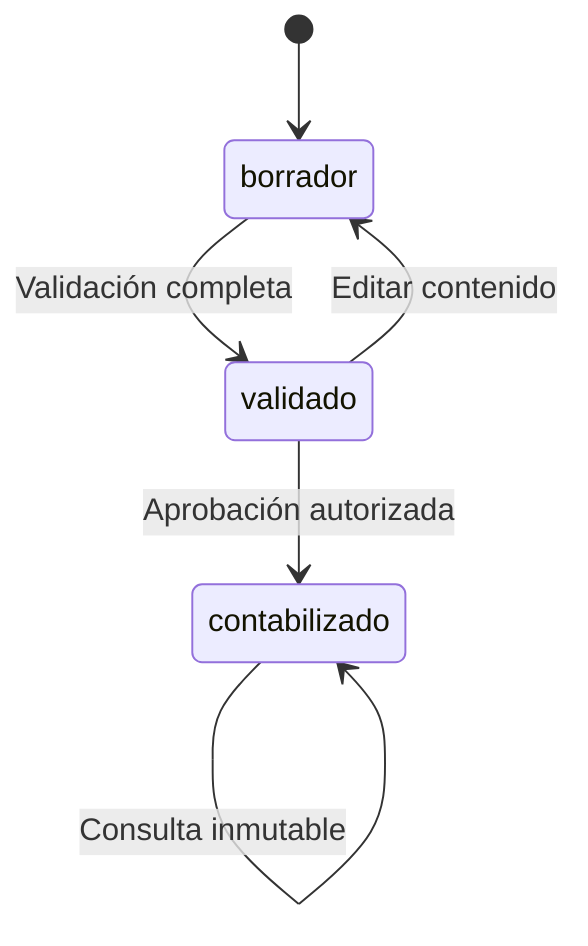

# 02 · Módulos, usuarios y flujos

**Proyecto:** Carlitos Finanzas. **Versión documental:** 0.1. **Fecha:** 19 de octubre de 2026.  
**Estado:** especificación funcional inicial; los recorridos descritos están pendientes de implementación.

## 1 Organización funcional

Los ocho módulos organizan lo que hace el producto. Comparten identidad, empresa, período, catálogo y procedencia; no constituyen ocho aplicaciones independientes. La agrupación proviene de los documentos Carlitos y se adapta a la arquitectura acordada. [F1, F2]

| Módulo | Responsabilidad | Entradas | Resultado principal | Fase |
| --- | --- | --- | --- | --- |
| 1. Usuarios y acceso | Resolver identidad, membresía y permisos | Usuario autenticado y asignación autorizada | Contexto de acceso activo | 01 |
| 2. Catálogo y períodos | Definir cuentas, rubros y períodos utilizables | Catálogo revisado y calendario | Estructura publicada y períodos abiertos/cerrados | 01 |
| 3. Importación y diario | Preparar, validar y aprobar registros | Archivos o asientos manuales | Diario contabilizado con origen | 02 |
| 4. Estados históricos | Derivar y conciliar cifras | Diario aprobado y política temporal | Comprobación y tres estados | 03 |
| 5. Presupuestos | Preparar y aprobar un plan mensual | Rubros, importes y previsión de efectivo | Versión de presupuesto y comparativo | 04 |
| 6. Pronósticos y escenarios | Aplicar métodos y supuestos visibles | Series comparables y parámetros | Pronóstico preliminar y escenarios versionados | 04 |
| 7. Estados proyectados | Integrar movimientos futuros | Cierre base, escenario y calendarios | Tres estados futuros conciliados | 05 |
| 8. Análisis y reportes | Explicar cifras y emitir versiones | Estados, indicadores y ejecuciones | Dashboard, análisis y PDF/XLSX | 03–05 |

La auditoría atraviesa todos los módulos. Configuración y auditoría son pantallas de apoyo. El balance de comprobación es un control del módulo histórico y no un cuarto estado comprometido.

## 2 Perfiles y matriz funcional

Los originales asignan la aprobación de presupuestos a cargos diferentes: administrador en la arquitectura y gerencia en el reporte. Se propone separar aprobación de asientos y aprobación de planes. Esta matriz es la configuración inicial de diseño y queda pendiente de ratificación funcional. [F1, F2]

| Operación | Administrador | Analista | Gerencia |
| --- | --- | --- | --- |
| Gestionar usuarios y membresías | Gestiona | Sin permiso | Sin permiso |
| Publicar catálogo | Publica | Propone y consulta | Consulta |
| Crear y configurar períodos | Gestiona | Consulta | Consulta |
| Cargar archivo, validar lote y confirmar a borradores | Supervisa; prepara solo con permiso explícito | Prepara | Consulta resultados autorizados |
| Crear/editar borrador manual | Supervisa; prepara solo con permiso explícito | Prepara | Consulta |
| Aprobar asientos | Aprueba | Sin permiso | Sin permiso |
| Revertir asiento | Autoriza con motivo | Solicita o prepara información | Consulta |
| Cerrar/reabrir período | Ejecuta con motivo | Solicita revisión | Consulta |
| Consultar diario, estados e indicadores | Consulta | Consulta y analiza | Consulta |
| Preparar presupuesto y escenario | Configura; prepara solo con permiso explícito | Prepara | Revisa |
| Aprobar presupuesto | Solo si recibe permiso explícito | Sin permiso | Aprueba o rechaza |
| Exportar reporte | Exporta lo autorizado | Exporta lo autorizado | Exporta lo autorizado |
| Consultar auditoría completa | Consulta | Solo con permiso explícito | Sin permiso por defecto |

La posibilidad de ver una pantalla no concede autorización para ejecutar su acción. Cambiar un identificador de empresa en una URL o solicitud tampoco concede acceso. Los permisos se comprobarán en cada caso de uso y en persistencia; su implementación pertenece a [08 Autenticación, permisos y auditoría](../tecnico/08_AUTENTICACION_PERMISOS_Y_AUDITORIA.md).

Se mantienen separados, entre otros, `usuarios.gestionar`, `catalogo.publicar`, `finanzas.leer`, `importaciones.preparar`, `asientos.preparar`, `asientos.aprobar`, `asientos.revertir`, `periodos.cerrar`, `periodos.reabrir`, `presupuestos.preparar`, `presupuestos.aprobar`, `escenarios.ejecutar`, `reportes.exportar` y `auditoria.leer`. La asignación excepcional debe ser explícita y auditable; no se deduce de la etiqueta «administrador».

## 3 Contexto común de trabajo

Después del acceso, cada consulta financiera identifica empresa, moneda, origen, período o intervalo y fecha de corte. El sistema distinguirá movimiento mensual, acumulado del ejercicio y saldo al corte. El mismo filtro se conservará al navegar desde el dashboard hacia estados y detalles.

El origen simulado de Carlitos será visible. Un análisis del caso Alfa se ejecutará sobre su fixture aislado, sin introducir sus cifras en el diario de Carlitos. Las advertencias de calidad acompañarán al resultado y a su exportación, especialmente cuando un saldo de cierre sustituya a un promedio o un mes sea estimado.

## 4 Flujo de acceso y preparación de la base

1. El usuario inicia sesión y el servidor valida su identidad.
2. Se resuelve una membresía activa y el conjunto de permisos del contexto autorizado.
3. Si no existe membresía activa, se explica que el acceso a datos no está habilitado; no se muestra un dashboard vacío que sugiera una empresa sin movimientos.
4. El administrador revisa el catálogo: jerarquía, naturaleza, cuenta de movimiento, rubro y vigencia.
5. Publica una versión utilizable y configura los períodos. Una cuenta de agrupación no puede recibir movimientos.
6. Se habilita la preparación del diario en períodos abiertos. Toda modificación relevante conserva actor y versión.

**Resultado:** la fase 01 dispone de identidad y estructura suficiente para aceptar registros. El detalle de contratos se encuentra en [10 Casos de uso](../tecnico/10_CONTRATOS_Y_CASOS_DE_USO.md), CU-01 a CU-04.

## 5 Flujo de importación a diario

El analista carga el archivo en `/importaciones`. El sistema conserva original y procedencia, verifica formato y estructura y crea un lote. La vista `/importaciones/[id]` permite comprobar cantidades, totales, períodos, cuentas y errores por hoja/fila.

| Estado del lote | Significado | Acción siguiente |
| --- | --- | --- |
| `recibido` | Archivo registrado y pendiente de validación | Iniciar validación |
| `validando` | Extracción y comprobación en curso | Esperar resultado; impedir confirmación |
| `con_errores` | Existen errores de contenido que bloquean el conjunto | Corregir mapeo o datos admitidos y revalidar |
| `listo` | La versión validada puede confirmarse | Confirmar a borradores |
| `confirmado` | La transacción creó todos sus borradores | Revisar y aprobar asientos por flujo separado |
| `fallido` | Una operación técnica no terminó | Mostrar causa operativa y permitir reintento controlado |

Modificar el mapeo o la normalización de un lote con errores crea otra versión de validación y conserva la anterior. Sustituir el archivo crea otro lote vinculado; el original no se sobrescribe. Una fila inválida nunca se elimina silenciosamente para conseguir que el archivo parezca correcto.

Al confirmar, el sistema vuelve a comprobar autorización, versión, períodos y consistencia. Se crean todos los borradores o ninguno. Repetir la misma operación con la misma clave y contenido devuelve su resultado anterior; cambiar el contenido con esa clave genera conflicto. La confirmación **no afecta todavía los estados financieros**.

Un usuario con `asientos.aprobar` revisa los asientos resultantes y autoriza su contabilización. El diario conserva el vínculo con lote, archivo, hoja y fila. Los estados comienzan a incluirlos después de esta aprobación. CU-05 a CU-11 y [11 Motor e importaciones](../tecnico/11_MOTOR_FINANCIERO_E_IMPORTACIONES.md) detallan el comportamiento.

## 6 Flujo de asiento manual, aprobación y reversión

El analista prepara fecha, concepto y líneas en `/diario/nuevo`. Mientras el asiento sea editable, el formulario muestra débitos, créditos y diferencia. Guardar cabecera y líneas constituye una operación conjunta.

La validación puede dejar un borrador preparado para aprobación; únicamente el estado `contabilizado` produce efectos en los estados. Una operación de aprobación puede revalidar y completar esa transición dentro de una transacción, sin requerir que el usuario abra dos pantallas distintas.

Un borrador o validado que no se utilizará puede descartarse mediante CU-08 con `asientos.preparar`, versión esperada y motivo. El descarte conserva cabecera, líneas, origen e identificadores y registra actor/fecha; no elimina el registro ni añade un cuarto estado contable. Un descartado deja de ser editable y aprobable y no bloquea el cierre por estar pendiente. No se descartan asientos contabilizados.

Corregir un asiento contabilizado exige reversión: se registra motivo, se crea un asiento opuesto en un período permitido y se vinculan ambos. El original sigue en los cálculos junto con su reversión. «Revertido» puede mostrarse como condición derivada del vínculo; no es un estado que elimine el efecto original de las sumas. Un reemplazo correcto, si hace falta, es otro asiento con su propio origen y aprobación.

## 7 Flujo de consulta, explicación y reporte

El usuario elige un intervalo y obtiene comprobación, resultados, situación o patrimonio. Los resultados incluyen corte, base temporal, revisión de datos y alertas de conciliación. Puede abrir un rubro, revisar cuentas y llegar a movimientos de Carlitos.

Un indicador muestra valor, unidad, fórmula, operandos, fuente y calidad. Si faltan datos, explica qué falta. Si el denominador es cero, devuelve un estado no calculable sin impedir que se muestren otros indicadores disponibles. La comparación temporal informa si los intervalos tienen distinta duración.

Al emitir un reporte se captura una ejecución coherente. Sus estados son `pendiente`, `generando`, `listo` o `fallido`. Solo una versión `listo` puede descargarse; el servidor comprueba nuevamente permiso y empresa. El archivo conserva los mismos valores, advertencias y versiones de la pantalla que lo originó. CU-12, CU-13, CU-19 y CU-20 especifican estas operaciones.

## 8 Flujo de presupuesto y escenarios

1. El analista crea un presupuesto por ejercicio y meses, con ventas, costos, gastos y entradas/salidas de efectivo.
2. Revisa que los rubros sean comparables con el histórico y envía la versión a revisión.
3. Gerencia aprueba o rechaza con observaciones. Un administrador solo puede aprobar si recibió expresamente ese permiso.
4. Una versión aprobada queda inmutable. Una modificación crea una nueva versión vinculada a la anterior.
5. El comparativo selecciona una versión específica y presenta real menos presupuesto, porcentaje y criterio favorable según el rubro.

| Estado de presupuesto | Edición permitida | Transición funcional |
| --- | --- | --- |
| `borrador` | Preparador autorizado | Enviar a `en_revision` |
| `en_revision` | Sin cambios durante la decisión | Aprobar o rechazar |
| `aprobado` | No; requiere nueva versión | Consultar o clonar para revisión futura |
| `rechazado` | Se conserva la decisión; la corrección crea nueva versión en borrador | Revisar observaciones y preparar versión sucesora |

El escenario agrega método, horizonte y supuestos versionados. Una vista preliminar puede comparar ventas o resultados parciales en fase 04, con su condición visible. En fase 05, publicar estados proyectados exige cierre base, puente temporal y movimientos conciliados de efectivo, cartera, inventario, deuda y patrimonio. Un factor favorable/adverso representa sensibilidad; no una probabilidad de ocurrencia.

## 9 Flujo de cierre y reapertura

El administrador consulta `/periodos/[id]/cierre`, revisa conciliación e incidencias y confirma el cierre con motivo. La transacción impide nuevas escrituras en ese período y guarda un snapshot con revisión, actor y fecha. Un cierre y una aprobación concurrentes deben resolverse ordenadamente: la operación que llegue después comprobará el estado actualizado.

Reabrir requiere permiso específico y motivo. Se conserva el cierre previo y se crea una revisión nueva. Los reportes antiguos mantienen sus cifras y versión; los análisis nuevos identifican el cambio de revisión. Este cierre del MVP no crea automáticamente asientos anuales de traslado de utilidad. CU-21 y CU-22 definen los contratos.

## 10 Incidencias que deben ser comprensibles

| Situación | Respuesta funcional |
| --- | --- |
| Sesión vencida | Solicitar nuevo acceso sin simular que se completó la operación |
| Usuario sin permiso | Explicar acción no autorizada y no alterar datos |
| Error de fila | Indicar hoja, fila, campo, regla y forma de corregir |
| Período cerrado | Mostrar período afectado y detener la escritura completa |
| Versión obsoleta | Pedir recarga y comparación antes de reintentar |
| Reintento de la misma operación | Recuperar resultado anterior sin duplicar efectos |
| Indicador no calculable | Mostrar causa y mantener visibles los indicadores válidos |
| Proyección sin puente o sin conciliación | Mostrar faltantes y conservarla como parcial |
| Fallo al generar archivo | Mantener estado fallido y permitir reintento autorizado |

Las pantallas concretas y sus componentes se detallan en [09 Pantallas y Atomic Design](../tecnico/09_PANTALLAS_Y_ATOMIC_DESIGN.md). El recorrido dirigido para usuarios se encuentra en [21 Manual previsto y demostración](../validacion_y_entrega/21_MANUAL_DE_USUARIO_Y_DEMOSTRACION.md).

## 11 Fuentes

- **F1:** `Carlitos_ARQUITECTURA_TECNICA_DETALLADA.docx`, módulos, roles, estructura y aprobación de presupuestos.
- **F2:** `Carlitos_Reporte_Mejorado.docx`, secciones 5–8, recorridos de importación, análisis y planificación.
- Los estados, permisos separados y transiciones precisas de este documento son decisiones de diseño de la versión 0.1; deben conservarse sincronizados con [03 Requerimientos](03_REQUERIMIENTOS_Y_CRITERIOS_DE_ACEPTACION.md), [08 Seguridad](../tecnico/08_AUTENTICACION_PERMISOS_Y_AUDITORIA.md) y [10 Contratos](../tecnico/10_CONTRATOS_Y_CASOS_DE_USO.md).

**Volver:** [Índice documental](../00_INDICE_Y_PLAN_DOCUMENTAL.md).
