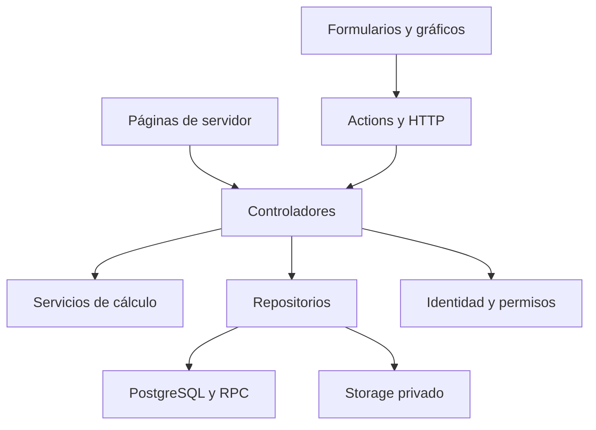

# 05 — Arquitectura y stack

**Proyecto:** Carlitos Finanzas  
**Versión documental:** 0.1 · **Fecha:** 19 de octubre de 2026  
**Estado:** especificación inicial desarrollada; implementación y pruebas de aplicación pendientes.  
**Responsable funcional:** equipo del proyecto. **Responsable técnico previsto:** responsable de arquitectura.

## 1. Decisión de arquitectura

Construir un **monolito modular con Next.js App Router, TypeScript y Supabase**. Una aplicación Next.js servirá las pantallas, resolverá las operaciones del servidor y generará archivos. Supabase aportará identidad, PostgreSQL y almacenamiento privado. Docker ejecutará el entorno local de Supabase mediante su CLI.

La elección responde a la preferencia del proyecto por Next.js y Supabase y mantiene los ocho módulos definidos en los materiales de Carlitos. La propuesta anterior utilizaba Django; este documento sustituye ese stack y conserva los requisitos financieros. No se necesita introducir una plataforma de agentes de IA: los resultados se obtendrán mediante reglas deterministas y verificables. [F1, F2]

La unidad de despliegue de aplicación es Next.js. La unidad de integridad financiera es la transacción de PostgreSQL. El cálculo puro puede ejecutarse en TypeScript, pero contabilizar, revertir y cerrar requieren las restricciones y operaciones atómicas descritas en los documentos [07](07_MODELO_DE_DATOS_Y_MIGRACIONES.md), [08](08_AUTENTICACION_PERMISOS_Y_AUDITORIA.md) y [10](10_CONTRATOS_Y_CASOS_DE_USO.md).

## 2. Límites del sistema

| Área | Incluye | Límite inicial |
| --- | --- | --- |
| Interfaz | Pantallas por módulo, filtros, formularios, tablas y gráficos | Datos persistidos y permisos se obtienen del servidor |
| Aplicación | Autorización, coordinación de casos de uso, validación de entrada | Los adaptadores HTTP y Actions no contienen las fórmulas |
| Dominio | Contabilidad, estados, indicadores, presupuestos y proyecciones | Funciones puras; ninguna dependencia de React, cookies o Supabase |
| Persistencia | Datos por empresa, restricciones, transacciones, RLS, snapshots | Ninguna edición independiente de totales de estados |
| Archivos | Originales importados y reportes emitidos | Buckets privados, procedencia y descarga autorizada |
| Operación | Migraciones, semillas, desarrollo local, respaldo y recuperación | Reproducción local desde archivos versionados |

La primera empresa será la Panadería Carlitos académica, moneda USD y datos simulados. El modelo incluirá empresa y membresía para aislar registros. La interfaz inicial no necesita administrar un SaaS. El caso Alfa será un conjunto de datos de referencia del motor, aislado de los asientos de Carlitos. Los límites funcionales completos están en [01](../negocio/01_VISION_Y_ALCANCE.md).

## 3. Flujo de dependencias

| Capa | Responsabilidad | Entradas y salidas | Dependencias permitidas |
| --- | --- | --- | --- |
| `src/app` | Resolver URL, parámetros y composición de pantalla | Parámetros validados, JSX o respuesta HTTP | Controladores, componentes, schemas, rutas |
| `src/components` | Presentación y estado de interacción | Props de DTO y callbacks | Tipos de presentación, componentes inferiores |
| `src/controladores` | Ejecutar CU-01 a CU-23 | Comandos y consultas → DTO o error de dominio | Auth, servicios, repositorios, schemas |
| `src/servicios` | Aplicar RCF-01 a RCF-20 | Datos normalizados y políticas → resultados | Tipos de dominio y utilidades puras |
| `src/repositorios` | Leer datos y llamar a RPC | Filtros/contexto → registros normalizados | Clientes Supabase y tipos generados |
| `src/supabase` | Integración y clientes por contexto | Configuración/cookies → cliente | Paquetes Supabase y APIs del servidor |
| `supabase/` | Esquema, integridad y seguridad | SQL versionado | PostgreSQL y capacidades habilitadas |

Los controladores y repositorios cumplen la función de una capa de acceso a datos del servidor; no se añade una segunda carpeta `dal` con operaciones duplicadas. Un controlador devuelve solo los campos necesarios para su consumidor. Los módulos del servidor que accedan a identidad, datos o secretos declararán `import 'server-only'`. Esta separación sigue la orientación de seguridad de datos de Next.js. [T1]

## 4. Lecturas, escrituras y cálculo

### 4.1 Lectura inicial de una pantalla

Una página valida sus parámetros, llama al controlador y recibe el DTO. El controlador resuelve identidad y empresa, consulta una base coherente y ejecuta los servicios de cálculo necesarios. Una página de servidor no realiza HTTP contra su propio `/api` para leer información que puede obtener directamente de su controlador. [T2]

Ejemplo: `/estados/resultados?desde=2025-01-01&hasta=2025-12-31` delega en CU-12. La respuesta contiene rubros, valores decimales como texto, origen, período, revisiones y advertencias. El componente de estado financiero presenta esa respuesta sin recalcular la utilidad en React.

### 4.2 Escritura desde un formulario

Una Server Action recibe datos sin confiar en ellos, los valida y delega en el controlador. Este exige el permiso y ejecuta la RPC correspondiente mediante un repositorio. Solo tras un resultado confirmado se revalida la vista afectada. Cerrar un modal, ocultar un botón o desactivar un campo no sustituye una verificación de acceso.

Las mutaciones financieras revalidan su estado dentro de PostgreSQL. La cabecera, las líneas, el cambio de estado, la revisión y la auditoría pertenecen a una misma transacción. Confirmar un lote crea borradores; aprobar asientos les da efecto contable.

### 4.3 Frontera servidor–navegador

Páginas y layouts conservarán su comportamiento de servidor. La directiva `'use client'` se aplicará a formularios con estado, controles interactivos, tablas que requieran interacción y gráficos concretos. [T3]

El navegador puede mantener una pestaña seleccionada, el estado de un formulario o una selección de filas. Los filtros que definen un resultado reproducible —fechas, base temporal, período y escenario— viven en la URL. El usuario, sus permisos y el diario persistido no dependerán de un almacén global del navegador.

## 5. Reutilización y ciclo de vida

La carpeta `controladores` agrupa operaciones repetibles por módulo. La reutilización se consigue con funciones, módulos y, cuando se necesite inyección de dependencias, fábricas sencillas. No es necesario crear una clase singleton para cada módulo.

Se pueden compartir rutas, definiciones tipadas de permisos, formatos y catálogos inmutables de fórmulas. En cambio, el cliente Supabase del servidor y cualquier contexto que contenga usuario, empresa o permisos se crean por solicitud. La documentación SSR de Supabase advierte sobre compartir clientes de servidor entre solicitudes. [T4]

Una instancia configurada de aritmética decimal puede exponerse desde `lib/decimal.ts`, siempre que su configuración sea fija y no se altere por usuario. El cálculo recibe una política como argumento; no modifica un estado global para cambiar de empresa o fórmula.

## 6. Stack y adopción por fases

| Necesidad | Elección propuesta | Incorporación |
| --- | --- | --- |
| Aplicación | Next.js App Router, TypeScript estricto | Fase 01 |
| Identidad y datos | `@supabase/supabase-js`, `@supabase/ssr`, PostgreSQL | Fase 01 |
| Estilos | Tailwind CSS y tokens del proyecto | Fase 01 |
| Componentes base | shadcn/ui adaptado a Atomic Design | Fase 01 |
| Validación | Zod en formularios, rutas y entradas | Fase 01 |
| Aritmética | `numeric` en PostgreSQL y decimal.js en servicios | Desde datos monetarios |
| Gráficos | Apache ECharts con módulos necesarios | Fase 03 |
| Lectura y escritura XLSX | ExcelJS en runtime Node | Importación fase 02; exportación fase 05 |
| Generación PDF | pdf-lib en runtime Node | Fase 05 |
| Entorno local | Docker y Supabase CLI | Fase 01 |
| Gestión de paquetes | npm y lockfile versionado | Fase 01 |

Las versiones exactas se fijarán al crear el repositorio, comprobando compatibilidad entre Node, Next.js, React y la CLI. El paquete documental no afirma que esas dependencias ya estén instaladas. El [documento 12](12_ENTORNO_LOCAL_Y_OPERACION.md) define el procedimiento reproducible.

## 7. Datos, precisión y reproducción

El diario contabilizado es la fuente de los estados históricos. Las hojas de estados del Excel sirven para contrastar, no para reemplazar silenciosamente el resultado del diario. Una proyección utiliza movimientos futuros separados, sin modificar los movimientos históricos.

Se usarán `numeric(18,2)` para dinero y strings decimales en contratos. La conversión SQL a texto debe ocurrir antes de construir JSON: recuperar un valor convertido previamente a `number` y después llamar a `toString()` no recupera precisión. Los cálculos usarán precisión de 40 dígitos y redondeo `ROUND_HALF_UP` según P-CARLITOS-1. Las reglas completas pertenecen a [04](../negocio/04_REGLAS_CONTABLES_Y_FINANCIERAS.md).

Cada ejecución reproducible conserva entradas normalizadas, origen, corte, política, versión de fórmulas y revisiones de datos y catálogo. Una consulta base debe capturar esas piezas de forma coherente. Antes de publicar, se comprueba que las revisiones siguen vigentes; una ejecución anterior permanece identificada con su revisión.

## 8. Transacciones, archivos y trabajo de duración variable

PostgreSQL y Storage no forman una sola transacción de la aplicación. El original se guarda en una ruta privada e inmutable antes de registrar el lote. Un fallo posterior conserva un estado recuperable o deja un objeto para limpieza controlada mediante la API de Storage. La aplicación no elimina objetos manipulando directamente `storage.objects`. [T5]

En el volumen académico inicial se prevé procesar cargas y archivos dentro del servidor con límites explícitos y estados persistidos. Si las mediciones demuestran que el tiempo de generación excede el presupuesto del runtime, se incorporará un ejecutor de trabajos duradero. No se promete una cola que aún no existe, ni se considera fiable dejar una promesa sin esperar después de responder HTTP. El contrato de estado del lote o reporte permite cambiar el ejecutor sin duplicar las reglas.

## 9. Decisiones y consecuencias

| Decisión | Motivo | Consecuencia que debe respetarse |
| --- | --- | --- |
| Monolito modular | Facilitar construcción y entrega académica | Mantener límites de capas para ampliar módulos |
| Carpetas por pantalla | Hacer visible el mapa de navegación | El sistema de archivos sigue definiendo las rutas |
| Atomic Design | Reutilizar interfaz coherente | Las páginas pertenecen a `app` |
| RPC de escritura estrechas | Mantener integridad y permisos | No abrir DML financiero directo al cliente |
| Bloqueo empresa → períodos → recurso | Simplificar revisiones y evitar orden de bloqueo contradictorio | Las escrituras de una empresa se serializan inicialmente |
| Snapshots inmutables | Explicar un resultado emitido | Una corrección produce una ejecución/version posterior |
| Clientes SSR por solicitud | Separar sesiones | Ninguna variable persistente conserva identidad |
| Motor determinista | Reproducir y contrastar fórmulas | Cada supuesto tiene versión y procedencia |

El coste de serializar escrituras por empresa es aceptable como decisión inicial de simplicidad para el volumen disponible; todavía debe medirse. No establece una garantía de concurrencia o tiempo de respuesta.

## 10. Criterio de aceptación arquitectónico

La arquitectura quedará materializada cuando el recorrido acceso → importación → aprobación → estados funcione con las capas descritas, los permisos se apliquen incluso llamando directamente a las operaciones y una ejecución pueda reproducirse con sus entradas. Las comprobaciones previstas se mantienen en [18](../validacion_y_entrega/18_PLAN_DE_PRUEBAS_Y_DATOS_DE_REFERENCIA.md); sus resultados reales se registrarán en [20](../validacion_y_entrega/20_REGISTRO_DE_VALIDACION_Y_PENDIENTES.md).

## Fuentes y documentos relacionados

- **F1:** `Carlitos_ARQUITECTURA_TECNICA_DETALLADA.docx`, módulos, arquitectura anterior y plan.
- **F2:** `Carlitos_Reporte_Mejorado.docx`, secciones 3 y 5–10.
- **T1:** [Next.js: Data security](https://nextjs.org/docs/app/guides/data-security).
- **T2:** [Next.js: Backend for Frontend](https://nextjs.org/docs/app/guides/backend-for-frontend).
- **T3:** [Next.js: Server and Client Components](https://nextjs.org/docs/app/getting-started/server-and-client-components).
- **T4:** [Supabase: Advanced SSR guide](https://supabase.com/docs/guides/auth/server-side/advanced-guide).
- **T5:** [Supabase: Storage schema](https://supabase.com/docs/guides/storage/schema/design).
- [Índice del paquete](../00_INDICE_Y_PLAN_DOCUMENTAL.md).

