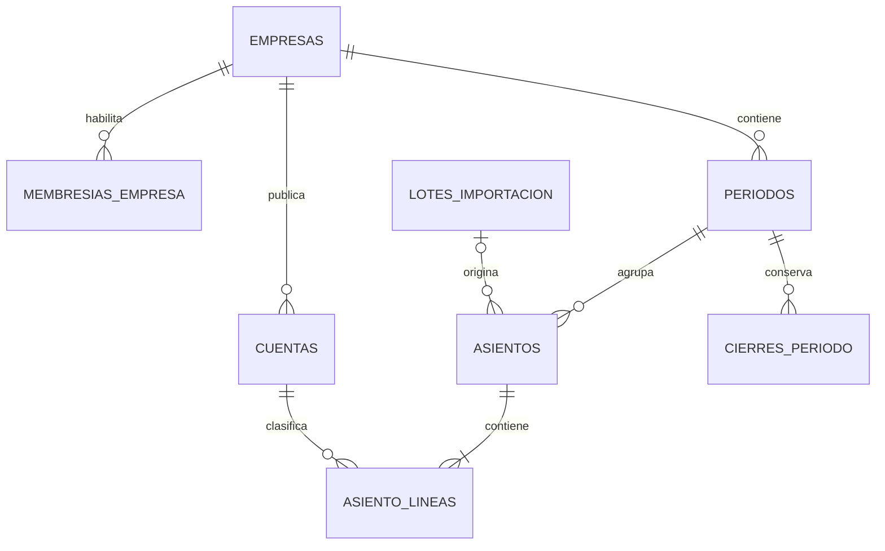

# 07 — Modelo de datos y migraciones

**Proyecto:** Carlitos Finanzas  
**Versión documental:** 0.1 · **Fecha:** 19 de octubre de 2026  
**Estado:** modelo lógico y restricciones propuestos; migraciones todavía pendientes de implementación.

## 1. Principios del modelo

Los asientos contabilizados, el catálogo publicado y las políticas versionadas constituyen la fuente del análisis histórico. Los estados, indicadores y comparativos son resultados derivados. Una ejecución emitida conserva una instantánea para reproducirse, sin crear una segunda contabilidad editable.

Toda entidad financiera pertenece a una empresa. El identificador recibido de la interfaz se contrasta con la membresía activa. El diseño incluye controles de empresa tanto en RLS como en claves foráneas compuestas: una cuenta o un período ajenos no pueden vincularse a un asiento aunque una consulta del servidor tenga un defecto.

Las tablas de aplicación se ubicarán en `public` con RLS habilitada. Los soportes internos que no deban aparecer en la API de datos, como la idempotencia y los helpers de autorización, se ubicarán en un esquema `private` no expuesto. Esta distribución es una decisión del proyecto; los permisos concretos están en [08](08_AUTENTICACION_PERMISOS_Y_AUDITORIA.md).

## 2. Relaciones centrales

El diagrama muestra el núcleo contable; presupuestos, ejecuciones y reportes se describen en sus tablas siguientes. Las líneas proyectadas se mantienen separadas de `asiento_lineas`.

## 3. Convenciones comunes

| Elemento | Convención |
| --- | --- |
| Identificadores | UUID para recursos de negocio y referencias a Auth |
| Propiedad | `empresa_id uuid not null` en entidades financieras |
| Fecha contable | `date`; se transporta como `YYYY-MM-DD` |
| Instantes | `timestamptz` para creación, aprobación, cierre y auditoría |
| Dinero | `numeric(18,2)`; entradas y salidas de aplicación como strings decimales |
| Tasas | `numeric` con mayor escala, propuesta `numeric(24,12)` para parámetros |
| Códigos | Texto; se conservan puntos, letras y ceros relevantes |
| Versiones | Enteros positivos; actualizaciones exigen versión esperada |
| Estados | Texto con `CHECK` o enum versionado; solo transiciones autorizadas |
| Eliminación | Se desactiva o versiona lo referenciado; se preserva historia |
| JSON | Procedencia, entradas y resultados normalizados; importes como texto dentro del JSON |

PostgreSQL `numeric` permite aritmética decimal exacta, mientras que un tipo flotante aproxima valores. El sistema validará la escala monetaria antes de convertir a `numeric(18,2)`, porque una conversión con escala puede redondear una entrada de mayor precisión. [T1]

En DTO monetarios se exige una representación canónica, por ejemplo `"20441.40"`. Las RPC de lectura convierten los importes a `text` antes de construir JSON. No se utilizará un valor JavaScript `number` como paso intermedio del transporte.

## 4. Identidad, empresa y autorización

| Tabla | Campos relevantes | Restricciones y uso |
| --- | --- | --- |
| `empresas` | `id`, nombre, moneda, origen_datos, zona_horaria, revision_datos, revision_catalogo, version | Moneda inicial USD; origen simulado explícito; revisiones avanzan al cambiar entradas del cálculo |
| `perfiles` | `id` referenciado a `auth.users`, nombre_visible, activo, creado_en | Sin contraseñas; el estado financiero de acceso se resuelve además en membresía |
| `membresias_empresa` | `empresa_id`, `usuario_id`, `rol_id`, activa, version | Única por empresa y usuario; cambio de rol mediante operación autorizada |
| `roles` | id, codigo, nombre | Códigos iniciales administrador, analista y gerencia |
| `permisos` | id, codigo, descripcion | Código único, sincronizado con `src/config/permisos.ts` |
| `rol_permisos` | rol_id, permiso_id | Clave compuesta; catálogo de asignaciones protegido |

El inicio de sesión de Auth y la membresía son capas diferentes. Un usuario autenticado sin membresía activa no obtiene acceso a datos de la empresa. No se confía en un campo de rol enviado por el navegador.

La operación de crear un usuario en Auth y asignar su membresía no es una transacción única entre servicios. El caso CU-02 conserva su resultado parcial, permite reintento idempotente y no concede acceso financiero hasta completar la membresía.

## 5. Catálogo, períodos y políticas

| Tabla | Campos relevantes | Restricciones y uso |
| --- | --- | --- |
| `rubros_financieros` | id, empresa_id, codigo, nombre, estado_financiero, padre_id, signo_presentacion | Jerarquía sin ciclos; códigos estables y clasificación versionada |
| `cuentas` | id, empresa_id, codigo, nombre, padre_id, clase, naturaleza, rubro_id, es_correctora, permite_movimiento, activa, vigencia_desde, vigencia_hasta, version | Única `(empresa_id,codigo)`; FKs compuestas a padre y rubro de la misma empresa |
| `periodos` | id, empresa_id, anio, mes, inicio, fin, estado, revision, siguiente_numero_asiento, version | Único `(empresa_id,anio,mes)`; período mensual válido; estado abierto o cerrado |
| `politicas_calculo` | id, empresa_id, codigo, version, parametros, hash, publicada_en, creada_por | Única `(empresa_id,codigo,version)`; una versión publicada es inmutable |

Una cuenta de agrupación no admite movimientos. La naturaleza y el signo de presentación son atributos separados: una cuenta correctora legítima no se corrige automáticamente porque tenga naturaleza distinta de la clase. Los cambios sobre un catálogo utilizado exigen revisar su impacto, incrementar `revision_catalogo` y conservar las clasificaciones capturadas en ejecuciones previas. Código y pertenencia a empresa de una cuenta utilizada no se editan para reinterpretar su identidad.

`periodos.siguiente_numero_asiento` asigna numeración visible bajo bloqueo. El número se reserva dentro de la operación que crea el asiento y se garantiza único por `(empresa_id,periodo_id,numero)`. No se consulta `MAX(numero)+1` fuera de una transacción. El número ayuda a identificar registros y no se presenta como garantía de una serie fiscal.

P-CARLITOS-1 define inicialmente USD, precisión de 40 dígitos en servicios, redondeo HALF_UP, fuentes temporales explícitas y tratamiento de faltantes. La definición funcional completa vive en [04](../negocio/04_REGLAS_CONTABLES_Y_FINANCIERAS.md); el JSON persistido debe implementar esa política y tener una versión identificable.

## 6. Importaciones y diario

| Tabla | Campos relevantes | Restricciones y uso |
| --- | --- | --- |
| `lotes_importacion` | id, empresa_id, archivo_ruta, hash_sha256, nombre_original, formato, version_mapeo, origen_datos, estado, version, lote_anterior_id, creado_por, resumen | Archivo original inmutable; reemplazo de archivo genera lote nuevo vinculado |
| `filas_importacion` | id, empresa_id, lote_id, hoja, numero_fila, original_json, normalizado_json, errores_json, version_validacion | Única procedencia por lote/hoja/fila; conserva original y diagnóstico |
| `asientos` | id, empresa_id, periodo_id, fecha, numero, tipo, estado, fuente, identificador_externo, lote_id, referencia_reversion_id, creado_por, aprobado_por, aprobado_en, version, descartado_en, descartado_por, motivo_descarte | FKs compuestas; original contabilizado inmutable; identificador externo único dentro de empresa y fuente |
| `asiento_lineas` | id, empresa_id, asiento_id, orden, cuenta_id, debe, haber, concepto, fila_importacion_id | Único `(asiento_id,orden)`; cuenta y asiento de la misma empresa; un único lado positivo |
| `private.operaciones_idempotentes` | empresa_id, operacion, clave, hash_payload, resultado_json, creado_por, creado_en | Única `(empresa_id,operacion,clave)`; sin acceso directo de usuario |

Cada línea debe tener importes finitos, no negativos y un solo lado mayor que cero. Se rechazan NaN, infinitos, ambos lados positivos y ambos lados cero. Las restricciones de línea se aplican en la tabla; la RPC comprueba adicionalmente estado, cuentas y conjunto completo.

Un borrador manual puede persistir desbalanceado para continuar la preparación, con al menos dos líneas válidas y diferencia visible. No afecta estados. El modo de validación exige cuadre para asignar estado `validado`. Un cambio posterior devuelve el asiento a `borrador`. Solo `contabilizado` integra las consultas financieras.

Descartar un asiento no contabilizado conserva cabecera, líneas, origen e identificadores y completa `descartado_en`, `descartado_por` y `motivo_descarte`. Es una marca administrativa separada de los tres estados contables. La RPC exige permiso, motivo y versión; el descartado no se edita ni aprueba, no bloquea el cierre y permanece consultable mediante filtro.

Confirmar una importación es más estricto: todas las filas y todos los asientos del lote deben ser válidos y cuadrados. La RPC crea el conjunto completo como borradores y registra la confirmación, o revierte todo. La aprobación vuelve a validar los asientos antes de contabilizar.

La integridad de cabecera y conjunto no se expresa con un `CHECK` que consulte otras filas. Se implementa en RPC y en validaciones/triggers de integridad de transición, respetando las escrituras transaccionales. El DML directo financiero permanece revocado.

Una reversión genera un asiento opuesto contabilizado, vinculado al original. Ambos siguen sumándose. La relación tendrá una restricción que impida una segunda reversión directa accidental del mismo original. Una corrección posterior de la reversión requiere otro procedimiento explícito y no una edición del asiento original.

## 7. Auditoría, cierres y ejecuciones

| Tabla | Campos relevantes | Restricciones y uso |
| --- | --- | --- |
| `auditoria` | id, empresa_id, actor_id, accion, entidad_tipo, entidad_id, instante, motivo, request_id, version_anterior, version_nueva, cambio_resumido | Inserción por operaciones autorizadas; sin UPDATE ni DELETE de usuarios |
| `cierres_periodo` | id, empresa_id, periodo_id, revision, snapshot_json, hash, cerrado_por, cerrado_en, reabierto_por, reabierto_en, motivo_reapertura | Conserva cada cierre y su reapertura; snapshot nunca se sobrescribe |
| `ejecuciones_analisis` | id, empresa_id, tipo, consulta_json, entradas_json, resultados_json opcional, hash_entradas, revision_datos, revision_catalogo, politica_id, version_formulas, creado_por, creado_en | Captura inmutable de operandos y procedencia; resultados derivados por motor versionado |
| `reportes` | id, empresa_id, tipo, fuente_tipo, fuente_id, formato, version, version_plantilla, estado, archivo_ruta, hash_archivo, creado_por, creado_en, error_codigo | Referencia a ejecución autorizada; emisión/descarga verificada desde captura y versiones |

El cierre del MVP congela el período y conserva saldos. No genera automáticamente asientos de cierre anual. La reapertura exige motivo, conserva el cierre previo e incrementa revisión. Los estados emitidos antes de reabrir permanecen disponibles con su fecha y revisión.

El snapshot de una ejecución se obtiene con una lectura coherente de entradas y revisiones. La publicación vuelve a comprobar esas revisiones dentro de una operación atómica. Si cambiaron, se devuelve conflicto para recalcular o se conserva expresamente como ejecución de revisión anterior, sin mezclar datos de consultas distintas.

Las RPC públicas de captura aceptan consultas y referencias y obtienen las entradas desde la base; no aceptan totales finales como autoridad. La decisión inicial es derivar resultados en el controlador con el motor versionado en cada lectura y emisión. `resultados_json` y las materializaciones proyectadas, si se conservan, son cachés verificables contra la captura protegida, sin escritura pública arbitraria. El archivo de Storage tampoco acredita por sí solo el resultado: la descarga recompone desde captura, motor y plantilla versionados, según el documento 10.

La referencia polimórfica `reportes.fuente_tipo/fuente_id` se validará dentro de la RPC: empresa, tipo admitido e inmutabilidad de la fuente. Si se adopta una FK física por cada fuente al implementar, debe preservarse la regla de exactamente una fuente y actualizarse el diccionario.

## 8. Presupuestos y proyecciones

| Tabla | Campos relevantes | Restricciones y uso |
| --- | --- | --- |
| `presupuestos` | id, empresa_id, ejercicio, codigo, version, estado, moneda, version_catalogo, creado_por, aprobado_por, aprobado_en, motivo_decision | Único empresa/código/versión; versión aprobada inmutable |
| `presupuesto_lineas` | id, empresa_id, presupuesto_id, mes, rubro_id, cuenta_id opcional, concepto, clase_flujo, importe | Mes 1–12, referencias de empresa coherentes; identifica presupuesto económico o de efectivo |
| `escenarios` | id, empresa_id, codigo, version, nombre, metodo, parametros_json, presupuesto_id, corte_base, creado_por, creado_en | Cada fila identifica una versión; cambios crean versión nueva |
| `ejecuciones_proyeccion` | id, empresa_id, escenario_id, corte_inicial, horizonte, entradas_json, supuestos_json, politica_id, revisiones_json, resultados_json, conciliaciones_json, creado_en | Inmutable; conserva cobertura y carácter estimado del puente |
| `movimientos_proyectados` | id, empresa_id, ejecucion_id, grupo_movimiento, fecha, cuenta_id, debe, haber, procedencia_json | Partida doble por grupo y conciliación por mes; nunca se mezcla con diario histórico |

`escenarios` guarda una fila por versión, evitando una segunda tabla de versiones sin necesidad. `ejecuciones_proyeccion` captura la versión exacta de escenario; modificar supuestos no cambia una ejecución emitida.

Las proyecciones preliminares parciales pueden guardarse con una marca de cobertura en sus resultados. Una proyección que se presente como integrada debe tener saldo inicial conciliado, puente de períodos faltantes y movimientos futuros balanceados. No se publica un balance con una cuenta inventada para absorber diferencias.

## 9. Índices y consistencia entre empresas

Las FKs compuestas requieren claves únicas de respaldo, por ejemplo `(empresa_id,id)` en períodos, cuentas, lotes y asientos. Las líneas referencian conjuntamente empresa y recurso.

Los índices iniciales cubrirán:

- Diario por empresa, período, fecha e identificador, y filtro por estado.
- Líneas por empresa/cuenta y por asiento.
- Membresías por usuario y empresa; permisos por rol.
- Lotes por empresa/fecha, hash y estado.
- Auditoría por empresa/instante y por entidad.
- Reportes y ejecuciones por empresa/fecha, fuente y versión.

Los índices adicionales se decidirán con planes y mediciones de consultas reales. Las listas usan paginación estable; una exportación no depende de los registros visibles de una sola página.

## 10. Plan de migraciones

| Migración lógica | Contenido mínimo | Momento |
| --- | --- | --- |
| Identidad, empresa y acceso | Tablas, membresías, roles, permisos, RLS, helpers y auditoría base | Fase 01 |
| Catálogo, períodos y políticas | Jerarquías, restricciones, lecturas y mutaciones estrechas | Fase 01 |
| Importación, diario y operaciones | Staging, idempotencia, RPC, Storage privado e integridad | Fase 02 |
| Consultas y análisis | Agregados con autorización, captura de bases y snapshots | Fase 03 |
| Presupuestos y escenarios | Versiones, aprobación y referencias de políticas | Fase 04 |
| Proyecciones, reportes y cierres | Movimientos futuros, archivos, cierre completo y recuperación | Fase 05 |

Cada migración crea sus restricciones, RLS y grants junto con las tablas. La seguridad no queda pospuesta a una migración final. Los nombres efectivos llevarán timestamps generados por la CLI. Una migración compartida ya aplicada no se reescribe; se añade otra para modificarla. El proceso local se describe en [12](12_ENTORNO_LOCAL_Y_OPERACION.md). [T2]

## 11. Aceptación y pendientes

La revisión del esquema debe demostrar que no puede vincular recursos de empresas distintas, escribir estados contables directamente, duplicar una operación confirmada o modificar un asiento contabilizado. Debe reconstruir el esquema y las semillas en una base local vacía, regenerar tipos y recuperar un respaldo de prueba.

Están pendientes el SQL ejecutable, las políticas verificadas, los tipos generados y todas las pruebas de aplicación. La auditoría del Excel proporcionado es evidencia de entrada, no una validación de estas migraciones. La relación completa de comprobaciones está en [18](../validacion_y_entrega/18_PLAN_DE_PRUEBAS_Y_DATOS_DE_REFERENCIA.md).

## Fuentes y documentos relacionados

- **T1:** [PostgreSQL: Numeric types](https://www.postgresql.org/docs/current/datatype-numeric.html).
- **T2:** [Supabase: Database migrations](https://supabase.com/docs/guides/local-development/database-migrations).
- [04 Reglas contables](../negocio/04_REGLAS_CONTABLES_Y_FINANCIERAS.md), [08 Seguridad](08_AUTENTICACION_PERMISOS_Y_AUDITORIA.md), [10 Contratos](10_CONTRATOS_Y_CASOS_DE_USO.md).

